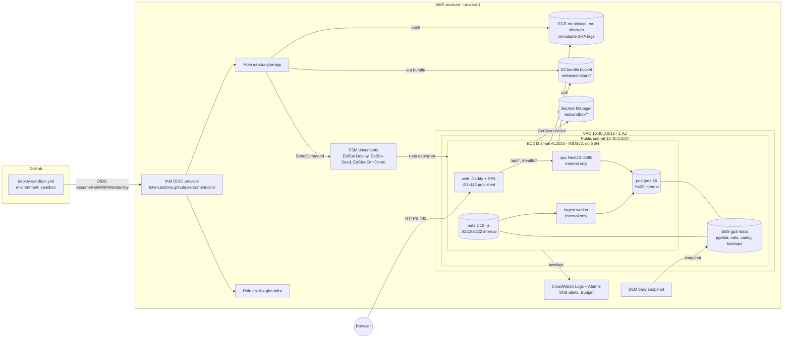

# Sandbox POC deployment to AWS (ADR-SBX-001 + deployment model)

| Field         | Value                                                                                                                                                                     |
| ------------- | ------------------------------------------------------------------------------------------------------------------------------------------------------------------------- |
| Status        | **Proposed** (author: solution-architect agent; approval by the Product/Engineering Owner, not by any agent)                                                              |
| Branch / base | `deploy/sandbox-aws-poc` @ `185f563`                                                                                                                                      |
| Scope         | Sandbox proof-of-concept only. Non-production AWS account, **synthetic seed data only, no real PII**                                                                      |
| Expiry        | **2026-12-03** (owner, 2026-11-04), or when HG-4 is approved for the P4 design, whichever is first. Matches exception EX-001                                              |
| Not           | This is **not** the P4 deployment design. It is outside the gated lifecycle and does not change `docs/requirements/**`, `docs/ux/**`, `docs/design/**` or `docs/plans/**` |

Nothing in this document has been deployed or tested. Every cost figure is an estimate (us-east-1 on-demand list prices) that needs checking in the AWS Pricing Calculator.

---

## 1. ADR-SBX-001 - Sandbox POC deployment of event-analytics to AWS

### 1.1 Context

- Commit `185f563` contains a runnable vertical slice that was built outside the SDLC lifecycle. It has a NestJS API with Prisma (`apps/api`), a standalone NATS ingest worker (`apps/api/src/ingestion/ingestion.standalone.ts`), a React + Vite web app (`apps/web`) and the shared packages `@ea/contracts` and `@ea/producer-client`.
- The formal P4 design (`design/event-analytics` @ `7c44431`) is still in review. HG-3 and HG-4 are pending.
- The project is Risk Tier 3 because the events contain PII. The owner has declared an **exception** so the slice can be demonstrated in AWS, on these conditions: a non-production account, synthetic data only, and the deployment is torn down (or reconciled through the lifecycle) before any real data is used.
- Today the slice only runs locally. `docker-compose.yml` defines Postgres and NATS only, the API and worker run through `ts-node-dev`, and there are no Dockerfiles (see section 7).

### 1.2 Decisions (owner-decided, recorded here; not re-opened)

| #   | Decision                                                                                                                                     | Alternatives considered (briefly)                                                                                                                                  |
| --- | -------------------------------------------------------------------------------------------------------------------------------------------- | ------------------------------------------------------------------------------------------------------------------------------------------------------------------ |
| D1  | **One EC2 instance runs every container with docker compose**: Postgres 16, NATS 2.10 (JetStream), API, ingest worker, and web/reverse proxy | ECS Fargate + RDS (adds ~$15-30/mo for RDS, needs ALB ~$16/mo, NAT or endpoints); App Runner (no NATS); Lightsail (weaker IAM/OIDC/IaC story); EKS (far too heavy) |
| D2  | **IaC is AWS CDK (TypeScript)**, in a new npm workspace `infra/`                                                                             | Terraform (second toolchain); CloudFormation YAML (verbose, no types); click-ops (not reproducible, cannot be torn down reliably)                                  |
| D3  | **Deploy authentication is GitHub Actions OIDC** assuming IAM roles. No long-lived keys. Deployments run only from the pipeline              | IAM user access keys in GitHub secrets (long-lived, rotation burden); deploys from developer laptops (no audit trail, no gate)                                     |
| D4  | **Region is us-east-1**                                                                                                                      | eu-west-2 / eu-west-1 (closer to a UK owner but slightly dearer; no data-residency driver because the data is synthetic)                                           |

### 1.3 Decisions made in this ADR (architect-proposed)

Each decision lists at least two options. The **bold** option is the one chosen.

**D5 - How the web app is served**

| Option                                                                                                   | Trade-offs                                                                                                                                                                                  |
| -------------------------------------------------------------------------------------------------------- | ------------------------------------------------------------------------------------------------------------------------------------------------------------------------------------------- |
| **Caddy on the same instance, serving the SPA and reverse-proxying `/api/*` and `/health/*` to the API** | Same origin, so CORS and cross-site cookie problems go away. Automatic Let's Encrypt TLS. No extra AWS services, $0. Downside: TLS ends on the instance and the instance must accept 80/443 |
| S3 + CloudFront for the SPA, API on the instance                                                         | Better static performance, but the SPA and API become cross-origin (CORS, `SameSite`, CSRF). The API still needs its own TLS. More moving parts                                             |
| nginx + certbot                                                                                          | Same idea as Caddy, but certificate renewal has to be wired by hand                                                                                                                         |

Consequence: the web image is Caddy plus the static `dist/`. A Caddy data volume on the persistent disk keeps certificates across redeploys, which avoids Let's Encrypt rate limits.

**D6 - TLS and DNS**

| Option                                                                                                                                                        | Trade-offs                                                                                                                                                              |
| ------------------------------------------------------------------------------------------------------------------------------------------------------------- | ----------------------------------------------------------------------------------------------------------------------------------------------------------------------- |
| **A. Owner-supplied domain (Route 53 hosted zone or an external DNS A record) pointing at an Elastic IP; Caddy gets a Let's Encrypt certificate via HTTP-01** | Real certificate and a stable name. Costs $0.50/mo for a hosted zone if Route 53 is used                                                                                |
| **B. Fallback if no domain exists: `<eip-dashed>.sslip.io` (for example `3-90-12-34.sslip.io`) with a Let's Encrypt certificate**                             | No domain needed and still real TLS. Depends on a third-party wildcard DNS service and shared rate limits (confirm before relying on it). Acceptable for a sandbox only |
| C. Self-signed certificate / Caddy internal CA                                                                                                                | No external dependency, but every browser warns and the `__Host-` cookie flow becomes awkward                                                                           |

Decision: A if the owner supplies a domain (OQ-3), otherwise B. The site address is a CDK context value (`siteHost`) written to SSM parameter `/ea/sandbox/site-host`. The default assumption is **no domain, so B**.

**D7 - How images are built and delivered**

| Option                                                                                                                                          | Trade-offs                                                                                                                           |
| ----------------------------------------------------------------------------------------------------------------------------------------------- | ------------------------------------------------------------------------------------------------------------------------------------ |
| **Build in GitHub Actions, push to ECR (immutable tags = full commit SHA), then the instance pulls through an SSM Run Command custom document** | No SSH, no inbound management port, and the pipeline can do only what the document allows. Rollback just means "deploy an older SHA" |
| Build on the instance (git pull + docker build)                                                                                                 | Needs repository credentials and build tooling on the instance. Slow on a t3.small. Not reproducible                                 |
| CodeDeploy agent                                                                                                                                | Another agent and service for the same result                                                                                        |

**D8 - How runtime config reaches the instance**

| Option                                                                                                                                   | Trade-offs                                                                                                                               |
| ---------------------------------------------------------------------------------------------------------------------------------------- | ---------------------------------------------------------------------------------------------------------------------------------------- |
| **A per-SHA release bundle (`compose.sandbox.yml` + `deploy.sh`), uploaded by the workflow to a private S3 bucket at `releases/<sha>/`** | The compose file is versioned together with the images, so rollback is consistent. The instance needs `s3:GetObject` on that prefix only |
| Write the compose file in EC2 user data                                                                                                  | Any change replaces the instance or drifts from it                                                                                       |
| Ship the compose file inside the API image                                                                                               | Mixes concerns and needs an extra container just to read it                                                                              |

**D9 - Secrets**

| Option                                                                                                                                              | Trade-offs                                                                                    |
| --------------------------------------------------------------------------------------------------------------------------------------------------- | --------------------------------------------------------------------------------------------- |
| **Secrets Manager secrets with values generated by CDK (`generateSecretString`, no value appears in code). The instance reads them at deploy time** | Values never appear in the repo, CDK code or CloudFormation templates. $0.40/secret/mo        |
| SSM Parameter Store SecureString                                                                                                                    | Free, but CDK cannot create SecureString values, so a manual out-of-band step would be needed |

Non-secret configuration (site host, image repo URIs) lives in SSM Parameter Store standard parameters.

**D10 - Network**

| Option                                                                                                                                    | Trade-offs                                                                                                                                                     |
| ----------------------------------------------------------------------------------------------------------------------------------------- | -------------------------------------------------------------------------------------------------------------------------------------------------------------- |
| **A dedicated VPC with 1 AZ, 1 public subnet, no NAT gateway, and a free S3 gateway endpoint. The instance has a public IPv4 Elastic IP** | Cheapest option that still isolates the sandbox. Egress goes via the internet gateway to ECR, SSM, Secrets Manager and Let's Encrypt                           |
| Private subnet + NAT gateway (~$33/mo + data) or interface endpoints (~$7/mo each, roughly 6 needed)                                      | Better posture, but more than the rest of the stack combined. Not justified for synthetic data when the security groups already block everything except 80/443 |
| The default VPC                                                                                                                           | Shared with anything else in the account and harder to tear down cleanly                                                                                       |

### 1.4 Consequences

- Total cost is about $26-30/month (section 6.4). There is one point of failure: no high availability, and an AZ outage takes the sandbox down.
- Postgres, NATS and the app share 2 GiB RAM. Expect to step up to t3.medium if memory pressure appears.
- Each deploy causes a few seconds of downtime while the API container is recreated (single instance, no blue/green).
- Prisma migrations are forward-only. Rolling back code does not roll back the schema (section 6.5).
- Several application changes are needed before the stack can work (section 7). They are application code written **under the same exception** and need the owner's confirmation (OQ-1).
- Teardown is one `cdk destroy` per stack, plus manual deletion of the DLM snapshots and the CDK bootstrap stack (section 6.7).
- **Exit criteria:** on expiry, or before any real-data use, the sandbox is destroyed. Any successor deployment goes through the P4 design (HG-3/HG-4) and does **not** inherit these decisions automatically.

---

## 2. Deployment model

### 2.1 Diagram

### 2.2 Network layout

- VPC `10.40.0.0/16` with `maxAzs: 1` and `natGateways: 0`. One public subnet `/24` with a route to the internet gateway.
- An S3 gateway endpoint (free) keeps bundle and ECR layer traffic off the internet gateway.
- One Elastic IP is associated with the instance, giving a stable DNS target across stop/start.
- No IPv6. No load balancer.

### 2.3 Compute and storage

| Item                  | Value                                                                                                                                                                                | Rationale                                                                                                                                                   |
| --------------------- | ------------------------------------------------------------------------------------------------------------------------------------------------------------------------------------ | ----------------------------------------------------------------------------------------------------------------------------------------------------------- |
| Instance              | `t3.small` (2 vCPU, 2 GiB), x86_64                                                                                                                                                   | Cheapest size that fits Postgres + NATS + 2 Node processes + Caddy. x86 avoids multi-arch builds (argon2 and Prisma native binaries). Fallback: `t3.medium` |
| AMI                   | Amazon Linux 2023, **pinned** via `cdk.context.json` (not "latest")                                                                                                                  | Stops a new AMI from silently replacing the instance                                                                                                        |
| Swap                  | 1 GiB swapfile created in user data                                                                                                                                                  | Headroom for memory spikes                                                                                                                                  |
| Root volume           | gp3 20 GiB, encrypted                                                                                                                                                                | OS, Docker images, container metadata                                                                                                                       |
| Data volume           | gp3 20 GiB, encrypted, separate `ec2.Volume` mounted at `/data` (by UUID, in fstab), `RemovalPolicy.SNAPSHOT`, tag `ea:backup=daily`                                                 | Persists across instance replacement. Holds `/data/pg`, `/data/nats`, `/data/caddy`, `/data/backups`                                                        |
| Bootstrap (user data) | Install docker, the compose plugin (pinned release with checksum), and the CloudWatch-free awslogs setup (Docker's built-in driver). Mount `/data`. Create `/opt/ea`. Nothing secret |                                                                                                                                                             |
| Recovery              | CloudWatch alarm on `StatusCheckFailed_System` with the `ec2:recover` action                                                                                                         | Free self-healing for host failures                                                                                                                         |

### 2.4 Containers (`compose.sandbox.yml`, in the release bundle)

| Service     | Image                                | Command                                                | Ports published to host | Volumes / notes                                                                                                  |
| ----------- | ------------------------------------ | ------------------------------------------------------ | ----------------------- | ---------------------------------------------------------------------------------------------------------------- |
| `postgres`  | `postgres:16-alpine` (pinned digest) | default                                                | **none**                | `/data/pg:/var/lib/postgresql/data`; `POSTGRES_PASSWORD` is required (`${POSTGRES_PASSWORD:?}`), with no default |
| `nats`      | `nats:2.10-alpine` (pinned digest)   | `-js -sd /data -m 8222`                                | **none**                | `/data/nats:/data`                                                                                               |
| `migrate`   | `ea-sbx/api:<sha>`                   | `npx prisma migrate deploy`                            | none                    | profile `ops`, one-off                                                                                           |
| `seed`      | `ea-sbx/api:<sha>`                   | `node dist-seed/seed.js`                               | none                    | profile `ops`, one-off, guarded (section 3.7)                                                                    |
| `api`       | `ea-sbx/api:<sha>`                   | `node dist/main.js`                                    | **none**                | healthcheck `GET /health/ready`                                                                                  |
| `ingest`    | `ea-sbx/api:<sha>`                   | `node dist/ingestion/ingestion.standalone.js`          | **none**                | `restart: unless-stopped`                                                                                        |
| `emit-demo` | `ea-sbx/api:<sha>`                   | `node /app/packages/producer-client/dist/demo-emit.js` | none                    | profile `ops`, the only producer                                                                                 |
| `web`       | `ea-sbx/web:<sha>` (Caddy 2 + SPA)   | default                                                | **80, 443**             | `/data/caddy:/data`; `SITE_ADDRESS` from env                                                                     |

Every service uses `logging.driver: awslogs` with `awslogs-group: /ea/sandbox/<service>`. They share one compose network, and only `web` publishes ports.

### 2.5 Caddyfile (in the web image; summary)

- `{$SITE_ADDRESS}`: Caddy obtains the certificate automatically and redirects HTTP to HTTPS.
- `handle /api/*` and `handle /health/*` both `reverse_proxy api:8080`.
- `handle` (everything else): `root /srv`, `try_files {path} /index.html`, `file_server`.
- Response headers: `Strict-Transport-Security: max-age=31536000`, `X-Content-Type-Options: nosniff`, `Referrer-Policy: no-referrer`, `Content-Security-Policy: default-src 'self'; frame-ancestors 'none'`, `-Server`.
- Access log format is JSON **without** query strings or cookies (`log { format filter { request>uri query delete; request>headers>Cookie delete } }`, or the equivalent filter in the pinned Caddy version).

---

## 3. Security design (sandbox, synthetic data)

### 3.1 Access to the instance

- **No SSH.** There is no key pair and no port 22. Operator access is SSM Session Manager only, via the `AmazonSSMManagedInstanceCore` managed policy. Session logging goes to the CloudWatch log group `/ea/sandbox/ssm-sessions`.
- **IMDSv2 required** (`httpTokens: required`) with **hop limit 1**. Containers on the Docker bridge are one hop further away, so they cannot reach the instance role credentials. The `awslogs` driver and the deploy script run on the host, so they can.

### 3.2 Security group `ea-sbx-web`

| Direction | Port          | Source                                                                                                      | Why                                                                                                                 |
| --------- | ------------- | ----------------------------------------------------------------------------------------------------------- | ------------------------------------------------------------------------------------------------------------------- |
| Inbound   | 443/tcp       | `allowedCidrs` context value (default: owner-supplied list; `0.0.0.0/0` only if the owner accepts it, OQ-4) | Application                                                                                                         |
| Inbound   | 80/tcp        | `0.0.0.0/0`                                                                                                 | Let's Encrypt HTTP-01 challenge and HTTPS redirect only                                                             |
| Inbound   | anything else | none                                                                                                        | **5432, 4222, 8222, 8080 and 22 are never open.** Defence in depth: those ports are not published by compose either |
| Outbound  | all           | `0.0.0.0/0`                                                                                                 | ECR, S3, SSM, Secrets Manager, Let's Encrypt, OS packages                                                           |

Docker-published ports bypass host iptables rules. The security group is outside the instance and is the real control.

### 3.3 Encryption

- Turn on account-level EBS default encryption (a one-time CDK custom resource or a manual step), and set `encrypted: true` explicitly on both volumes. The key is AWS-managed `aws/ebs` (no KMS cost).
- S3 bundle bucket: SSE-S3, `BlockPublicAccess.BLOCK_ALL`, `enforceSSL: true`, lifecycle expiry of 90 days.
- ECR: AES-256 at rest, scan-on-push (basic), `IMMUTABLE` tags.
- In transit: TLS from the browser to Caddy. Traffic between containers is plaintext on the host-local bridge network, which is accepted for the sandbox.

### 3.4 Secrets

| Secret (Secrets Manager)  | Generated by                                                                                               | Consumer                                                              |
| ------------------------- | ---------------------------------------------------------------------------------------------------------- | --------------------------------------------------------------------- |
| `ea/sandbox/postgres`     | CDK `generateSecretString` (32 chars, `excludePunctuation: true`, so it is URL-safe inside `DATABASE_URL`) | `postgres`, and `DATABASE_URL` for `api`, `ingest`, `migrate`, `seed` |
| `ea/sandbox/seed-admin`   | CDK generated                                                                                              | `seed` (`SEED_ADMIN_PASSWORD`)                                        |
| `ea/sandbox/seed-analyst` | CDK generated                                                                                              | `seed` (`SEED_ANALYST_PASSWORD`)                                      |

- No secret value appears in the repo, CDK code, CloudFormation templates, GitHub secrets or the release bundle.
- `deploy.sh` reads the secrets with the instance role and writes `/run/ea/app.env` (tmpfs, `0600 root`) for `docker compose --env-file`.
- Residual risk (accepted for the sandbox): Docker keeps container environment in `/var/lib/docker` on the encrypted root volume, and it is visible to root through `docker inspect`.
- Rotation: change the secret, then re-run the deploy. Postgres password rotation also needs an `ALTER ROLE`, which is a documented runbook step.
- To get a seeded password, the owner reads it with `aws secretsmanager get-secret-value` under their own credentials. It is never printed in logs.

### 3.5 GitHub OIDC deploy roles (least privilege)

`EaSbxCiStack` creates one IAM OIDC provider (`token.actions.githubusercontent.com`, audience `sts.amazonaws.com`). If the account already has one, import it (OQ-2). It also creates two roles.

**Trust policy for both roles:**

- `token.actions.githubusercontent.com:aud = sts.amazonaws.com`
- `token.actions.githubusercontent.com:sub = repo:<ORG>/<REPO>:environment:sandbox` (StringEquals)

When a job uses a GitHub environment, the `sub` claim names the environment, not the branch. **Branch scoping** is therefore enforced by the environment's deployment-branch rule (only `deploy/sandbox-aws-poc`, and later `main` if the owner wants) plus a required reviewer (the owner). Optionally, also customise the repo's OIDC `sub` template to `repo,context,ref` and pin `ref:refs/heads/deploy/sandbox-aws-poc` in the trust policy for a second check.

| Role                                                    | Allowed actions (resource-scoped)                                                                                                                                                                                                                                                                                                                                                                                                                                                                                                                                                                                                                         |
| ------------------------------------------------------- | --------------------------------------------------------------------------------------------------------------------------------------------------------------------------------------------------------------------------------------------------------------------------------------------------------------------------------------------------------------------------------------------------------------------------------------------------------------------------------------------------------------------------------------------------------------------------------------------------------------------------------------------------------- |
| `ea-sbx-gha-app` (every deploy)                         | `ecr:GetAuthorizationToken` (`*`, required by AWS); `ecr:BatchCheckLayerAvailability, InitiateLayerUpload, UploadLayerPart, CompleteLayerUpload, PutImage, BatchGetImage, DescribeImages` on `ea-sbx/api` and `ea-sbx/web` only; `s3:PutObject` on `arn:aws:s3:::<bundle-bucket>/releases/*`; `ssm:SendCommand` on the `EaSbx-Deploy`, `EaSbx-Seed` and `EaSbx-EmitDemo` document ARNs **and** the instance ARN (condition `ssm:resourceTag/ea:app = event-analytics-sbx`); `ssm:GetCommandInvocation`, `ssm:ListCommandInvocations`; `ssm:GetParameter` on `/ea/sandbox/*` (non-secret). **No** `AWS-RunShellScript`, **no** Secrets Manager, **no** IAM |
| `ea-sbx-gha-infra` (`cdk deploy`, manual dispatch only) | `sts:AssumeRole` on the CDK bootstrap roles `cdk-hnb659fds-{deploy,file-publishing,image-publishing,lookup}-role-<acct>-us-east-1` only                                                                                                                                                                                                                                                                                                                                                                                                                                                                                                                   |

- Bootstrap with `cdk bootstrap --cloudformation-execution-policies <custom policy ARN>` that is limited to the services in section 2. If the owner instead accepts the default `AdministratorAccess` execution policy, that is acceptable **only** because the account is a dedicated sandbox; record it as residual risk.
- `EaSbxCiStack` itself is deployed **once, manually** by the owner with their own admin/SSO credentials. This breaks the chicken-and-egg problem: the roles have to exist before the pipeline can assume them.

### 3.6 Instance role `ea-sbx-instance`

- `AmazonSSMManagedInstanceCore`.
- ECR pull (`ecr:GetAuthorizationToken`, `BatchGetImage`, `GetDownloadUrlForLayer`, `BatchCheckLayerAvailability`) on the two repositories.
- `s3:GetObject` on `<bundle-bucket>/releases/*`.
- `secretsmanager:GetSecretValue` on the three `ea/sandbox/*` secret ARNs.
- `ssm:GetParameter` on `/ea/sandbox/*`.
- `logs:CreateLogStream, PutLogEvents, DescribeLogStreams` on the `/ea/sandbox/*` log groups. Log groups are created by CDK, so `awslogs-create-group` is false.
- Nothing else. In particular, no `ec2:*`, no `iam:*`, and no write access to S3 or ECR.

### 3.7 Logging and PII (CLAUDE.md "never log raw PII; redact in Pino")

- The project rule still applies, even though the sandbox holds synthetic data: the sandbox must not set a precedent of shipping raw payloads to CloudWatch.
- **Current state:** there is no Pino. Logging is `console.*` and two paths log raw error objects that can carry event or Prisma payload content: `apps/api/src/ingestion/ingestion.standalone.ts:95` (`console.error('intake error', err)`) and `apps/api/src/problem.filter.ts:43`.
- **Required before deploy (SBX-T3):**
  - Add `pino` (API: `nestjs-pino`) with `redact` paths covering `req.headers.cookie`, `req.headers["x-csrf-token"]`, `*.password`, `*.userId`, `*.context`, `*.properties`, `*.payload` and `err.meta`.
  - Log errors as `{ name, code, message }`, never as whole objects or envelopes.
  - Set the CloudWatch log group retention to 14 days.
- Caddy access logs strip query strings and cookies (section 2.5).

### 3.8 Guards that data stays synthetic

1. **No external producers are possible.** NATS (4222) is not published and is blocked by the security group, so the only producer is the on-instance `emit-demo` container (`packages/producer-client/src/demo-emit.ts`). It is started through SSM document `EaSbx-EmitDemo`.
2. **Seed guard.** `seed` refuses to run unless `EA_DATA_CLASSIFICATION=synthetic`. `deploy.sh` sets that variable only when the SSM parameter `/ea/sandbox/data-classification` equals `synthetic`, and CDK hard-codes that parameter. The stack also refuses to synthesise if the context value `dataClassification` is not `synthetic`.
3. **Tagging.** All resources carry `ea:data-classification=synthetic`, `ea:exception=ADR-SBX-001` and `ea:expires=<date>`.
4. **Visible banner.** The web app shows "SANDBOX - synthetic data only, do not enter real personal data" when `VITE_SANDBOX_BANNER=true` (SBX-T6). This matters because admin screens can create tenants and accounts, so procedural control still applies to anything typed into the UI.
5. **Seed credentials.** The hard-coded demo passwords (`apps/api/prisma/seed.ts:41-42`, printed at `:102-103`) must not be used on an internet-reachable host (SBX-T4).

---

## 4. Data

- **Migrations:** `deploy.sh` runs `docker compose run --rm migrate` (`prisma migrate deploy`, matching the existing script `apps/api/package.json:14`) **before** `docker compose up -d api ingest`. If the migration fails, the script exits non-zero, and the previous `api`/`ingest` containers keep running on the previous image. During a migration the _old_ API is briefly running against the _new_ schema, so migrations must stay expand/contract compatible, as CLAUDE.md requires.
- **Pre-migration dump:** before `migrate`, `deploy.sh` runs `pg_dump -Fc` to `/data/backups/<utc>-<prev-sha>.dump` and keeps the last 5. This gives a precise restore point for a bad migration.
- **Persistence:** Postgres data (`/data/pg`) and the JetStream store (`/data/nats`) live on the separate encrypted data volume, which survives container recreation and instance replacement.
- **Backups:** a DLM policy takes a daily snapshot of volumes tagged `ea:backup=daily` at 03:00 UTC and keeps 7. Snapshots are crash-consistent, which is acceptable because Postgres recovers through WAL replay.
- **Sandbox targets:** **RPO 24 h** (or the last pre-deploy dump if more recent). **RTO 2 h**, which is a manual restore: create a volume from the snapshot, swap it in by setting the CDK context `dataVolumeSnapshotId`, then deploy. Neither target is tested; SBX-T10 does one restore drill.
- **Seed:** run once after the first deploy, and on demand, through SSM document `EaSbx-Seed` (workflow input `seed: true`). It is idempotent (upserts, `apps/api/prisma/seed.ts:44-99`).

---

## 5. Operations

### 5.1 Health

- `GET /health/live` and `GET /health/ready` exist and are `@Public()` (`apps/api/src/health.controller.ts:10-26`).
- **Gap:** `ready` returns HTTP 200 with `{status:"error"}` when the database is down (`health.controller.ts:18`, `:23-25`). Until that is fixed (SBX-T5), the deploy gate and compose healthcheck must check the body for `"status":"ok"`, not just the status code. The fix is to return 503.
- The ingest worker has no health endpoint. Its liveness comes from `restart: unless-stopped` plus a log alarm (section 5.3).

### 5.2 Logs

- Docker `awslogs` driver sends each service to `/ea/sandbox/{api,ingest,web,postgres,nats}`, retention 14 days.
- Session Manager logs go to `/ea/sandbox/ssm-sessions`.
- No CloudWatch agent (it is not needed for container logs).

### 5.3 Alarms (all go to SNS topic `ea-sbx-alerts`, email subscription, OQ-5)

| Alarm            | Signal                                                                                                                                               | Action              |
| ---------------- | ---------------------------------------------------------------------------------------------------------------------------------------------------- | ------------------- |
| Instance health  | `StatusCheckFailed_System >= 1` for 2 x 1 min                                                                                                        | `ec2:recover` + SNS |
| Instance health  | `StatusCheckFailed_Instance >= 1` for 3 x 1 min                                                                                                      | SNS                 |
| App availability | Route 53 health check (HTTPS, string match `"status":"ok"`) on `https://<siteHost>/health/ready`, plus a CloudWatch alarm on `HealthCheckStatus < 1` | SNS                 |
| Worker crash     | Metric filter on `/ea/sandbox/ingest` for `"Ingestion worker failed"` (`ingestion.standalone.ts:120`), more than 0 in 5 min                          | SNS                 |
| Disk (optional)  | Metric filter on `/ea/sandbox/postgres` for `No space left on device`                                                                                | SNS                 |

### 5.4 Cost estimate (per month, us-east-1, on-demand, approximate)

| Item                                                               | Estimate    |
| ------------------------------------------------------------------ | ----------- |
| EC2 t3.small, 730 h                                                | ~$15.20     |
| EBS gp3 2 x 20 GiB                                                 | ~$3.20      |
| EBS snapshots (7 incremental, a few GiB)                           | ~$0.30      |
| Public IPv4 / Elastic IP                                           | ~$3.65      |
| ECR storage (lifecycle keeps 10 images per repo)                   | ~$0.50-1.00 |
| Secrets Manager x 3                                                | $1.20       |
| CloudWatch logs (<1 GB) + 5 alarms                                 | ~$1.00      |
| Route 53 health check (HTTPS + string match)                       | ~$2.50      |
| Route 53 hosted zone (only with option D6-A)                       | $0.50       |
| S3, SSM standard parameters, DLM, SNS email, data transfer (small) | ~$0.50      |
| **Total**                                                          | **~$28-30** |

- **Budget:** an AWS Budget `ea-sbx-monthly` of **$40** on actual cost, alerting at 50%, 80% and 100%, plus 100% forecast, sent to the alert email.
- Optional: stopping the instance outside working hours saves about $10/mo. The EIP is still charged while the instance is stopped.

### 5.5 Failure scenarios

| Scenario                            | Effect                            | Handling                                                                                |
| ----------------------------------- | --------------------------------- | --------------------------------------------------------------------------------------- |
| Host hardware failure               | Outage                            | `ec2:recover` restarts on new hardware with the same EBS volumes                        |
| AZ outage                           | Outage                            | Accepted. Rebuild in another AZ from a snapshot (RTO about 2 h, manual)                 |
| Bad release                         | App errors                        | Redeploy the previous SHA (section 6.5)                                                 |
| Migration fails                     | Deploy aborts                     | Old containers keep serving. Fix forward, or restore from the pre-migration dump        |
| Disk full                           | Postgres stops                    | Alarm. Grow the gp3 volume online, then `resize2fs`/`xfs_growfs`                        |
| Let's Encrypt rate limit or failure | No HTTPS                          | Certificates persist in `/data/caddy`. Test against LE staging first. Fall back to D6-A |
| Ingest worker crash loop            | Events lost (core NATS, see G-12) | Log alarm. Acceptable for synthetic data                                                |
| Secret exposure                     | Compromised credentials           | Rotate in Secrets Manager, redeploy, invalidate sessions (truncate the session table)   |
| Cost runaway                        | Over budget                       | Budget alarm, then stop the instance or tear down                                       |

### 5.6 Teardown

1. Run `cdk destroy EaSbxAppStack` (from the infra workflow or by the owner). This:
   - **Terminates** the instance.
   - **Snapshots and then deletes** the data volume (`RemovalPolicy.SNAPSHOT`).
   - Deletes the ECR repositories (`emptyOnDelete`), the bundle bucket (`autoDeleteObjects`), log groups, alarms, SSM documents and parameters, the DLM policy, the security group, the VPC, the EIP and the Route 53 health check.
   - Schedules the secrets for deletion (7-day recovery window).
2. **Retained (manual clean-up):**
   - The final data-volume snapshot.
   - DLM-created snapshots, which are not deleted when the policy is deleted.
   - Find them by tag `ea:app=event-analytics-sbx` and delete them once the owner confirms nothing is needed (the data is synthetic, so the default is to delete).
3. Run `cdk destroy EaSbxCiStack`. This removes the OIDC roles, the budget and the SNS topic, and also the OIDC provider unless it was imported.
4. Optional: delete the `CDKToolkit` bootstrap stack and its staging bucket and ECR repository if nothing else in the account uses CDK.
5. Delete the GitHub environment `sandbox`, or remove its reviewers.
6. Record teardown evidence (stack deletion events, snapshot deletion) in `reports/sandbox/teardown-<date>.md`.

---

## 6. Deploy and rollback flow

### 6.1 GitHub configuration

- Environment **`sandbox`**:
  - Deployment branches: `deploy/sandbox-aws-poc` only.
  - Required reviewer: the owner (alextthomas).
  - Environment **variables, not secrets**: `AWS_ACCOUNT_ID`, `AWS_REGION=us-east-1`, `APP_ROLE_ARN`, `INFRA_ROLE_ARN`, `BUNDLE_BUCKET`, `SITE_HOST`.
- No AWS keys anywhere.

### 6.2 Workflow `.github/workflows/deploy-sandbox.yml`

Triggers: `push` to `deploy/sandbox-aws-poc`, and `workflow_dispatch` with inputs `sha` (optional, used for rollback), `seed` (boolean) and `emitDemo` (boolean). Concurrency group `deploy-sandbox` with `cancel-in-progress: false`.

1. **`qa`** - calls the existing CI as a reusable workflow (`uses: ./.github/workflows/ci.yml`). This needs `workflow_call` added to `ci.yml:3-6`. Skipped when `inputs.sha` is set, because that is a rollback to an already-built SHA.
2. **`build`** (`needs: qa`, `environment: sandbox`, `permissions: { id-token: write, contents: read }`):
   1. Check out the code.
   2. Run `aws-actions/configure-aws-credentials` (pinned by SHA) with `role-to-assume: ${{ vars.APP_ROLE_ARN }}`.
   3. Log in to ECR.
   4. `docker buildx build -f apps/api/Dockerfile -t <ecr>/ea-sbx/api:${{ github.sha }} --push .`
   5. `docker buildx build -f apps/web/Dockerfile --build-arg VITE_SANDBOX_BANNER=true -t <ecr>/ea-sbx/web:${{ github.sha }} --push .`
   6. Upload `infra/sandbox/runtime/{compose.sandbox.yml,deploy.sh}` to `s3://$BUNDLE_BUCKET/releases/${{ github.sha }}/`.
3. **`deploy`** (`needs: build`, `environment: sandbox`):
   1. Assume the app role.
   2. `aws ssm send-command --document-name EaSbx-Deploy --targets Key=tag:ea:app,Values=event-analytics-sbx --parameters imageTag=<sha>`.
   3. Poll `get-command-invocation` until it finishes (timeout 15 min). Fail the job if the status is not `Success`.
   4. If `seed`: run the `EaSbx-Seed` document. If `emitDemo`: run the `EaSbx-EmitDemo` document.
4. **`smoke`**: `curl -fsS https://$SITE_HOST/health/ready | grep '"status":"ok"'`, and `curl -fsS https://$SITE_HOST/` returns the SPA. Write a job summary with the SHA and the SSM command ID.

Separate workflow **`infra-sandbox.yml`** (`workflow_dispatch` only, `environment: sandbox`, infra role): `npm ci`, `npx cdk diff`, then `npx cdk deploy EaSbxAppStack --require-approval never`. The environment's reviewer approval is the human gate.

### 6.3 SSM document `EaSbx-Deploy`

- Parameter `imageTag` must match `^[0-9a-f]{40}$`. That regex is the only input, so the pipeline cannot run arbitrary shell.
- Steps:
  1. `aws s3 cp s3://<bucket>/releases/{{imageTag}}/ /opt/ea/releases/{{imageTag}}/ --recursive`
  2. `bash /opt/ea/releases/{{imageTag}}/deploy.sh {{imageTag}}`

### 6.4 `deploy.sh <sha>` (runs as root on the instance)

1. `set -euo pipefail`.
2. Read `/ea/sandbox/*` parameters and the `ea/sandbox/*` secrets, then render `/run/ea/app.env` (mode 0600). This sets:
   - `DATABASE_URL=postgresql://ea:<pw>@postgres:5432/event_analytics?schema=control`
   - `NATS_URL=nats://nats:4222`
   - `API_PORT=8080`
   - `WEB_ORIGIN=https://<siteHost>`
   - `SESSION_COOKIE_NAME=__Host-ea_sid`
   - `COOKIE_SECURE=true`
   - `SITE_ADDRESS=<siteHost>`
   - `EA_DATA_CLASSIFICATION`
   - `IMAGE_TAG=<sha>`
3. Log in to ECR and run `docker compose pull`.
4. `docker compose up -d postgres nats`, then wait for both to be healthy.
5. If an API is already running, `pg_dump -Fc` to `/data/backups/` and prune to the last 5.
6. `docker compose run --rm migrate`. Abort on a non-zero exit.
7. `docker compose up -d --no-deps api ingest`. Wait up to 90 s for `docker exec api` to return `"status":"ok"` from `/health/ready`. Abort if it does not.
8. `docker compose up -d --no-deps web`.
9. Write `/opt/ea/current` = `<sha>` and `/opt/ea/previous` = the old value. Run `docker image prune` on images older than the last 3 SHAs.

### 6.5 Rollback

- Run **`workflow_dispatch` with `sha=<previous SHA>`**. This skips `qa` and `build`, so the images and bundle must still exist (ECR keeps the last 10, S3 keeps 90 days), and runs `deploy` and `smoke` for that SHA.
- **Migration caveat:** rolling back does **not** reverse migrations. `prisma migrate deploy` on the older image is a no-op for migrations it does not know about.
  - Rollback is safe only if the newer migration was additive (expand).
  - Otherwise, restore the pre-migration dump (`pg_restore --clean` from `/data/backups/<ts>-<prev-sha>.dump` through a Session Manager runbook), then redeploy the old SHA.
  - Destructive (contract) migrations need a separate deploy after the code that no longer uses the dropped objects.
- Image tags are immutable full SHAs, never `latest`.

---

## 7. Gap list (current code vs. what this deployment needs)

`.env.example` could not be read (permission-denied path in this session), so its variables are inferred from `config.ts` and `ci.yml`.

| ID   | Gap                                                                                                                                   | Evidence                                                                                                              | Fix (task)                                                                                                                                                                                                                                                                                                         |
| ---- | ------------------------------------------------------------------------------------------------------------------------------------- | --------------------------------------------------------------------------------------------------------------------- | ------------------------------------------------------------------------------------------------------------------------------------------------------------------------------------------------------------------------------------------------------------------------------------------------------------------ |
| G-1  | No Dockerfiles or `.dockerignore`                                                                                                     | No `**/Dockerfile*` in the repo                                                                                       | Multi-stage `apps/api/Dockerfile` (node:22-bookworm-slim, `apt-get install openssl` for Prisma, `npm ci`, build contracts + producer-client + api, `prisma generate`, prune) and `apps/web/Dockerfile` (build, then caddy:2-alpine). `.dockerignore` excludes `.env*`, `node_modules`, `coverage`, `.git` (SBX-T2) |
| G-2  | Session cookie is never `Secure`, so the `__Host-` prefix is impossible                                                               | `apps/api/src/auth/auth.controller.ts:27` (`secure: false`)                                                           | Make it configurable (`COOKIE_SECURE`, default false) in `config.ts`; use it at `:27` (SBX-T5)                                                                                                                                                                                                                     |
| G-3  | `clearCookie` does not repeat the cookie attributes, so a `Secure`/`__Host-` cookie may not be cleared on sign-out                    | `auth.controller.ts:73`                                                                                               | Pass the same `{ path, secure, httpOnly, sameSite }` options (SBX-T5)                                                                                                                                                                                                                                              |
| G-4  | The web app's API base defaults to `http://localhost:8080` in production builds                                                       | `apps/web/src/api.ts:19`                                                                                              | Default to `''` (same-origin) when `import.meta.env.PROD`. Keep `VITE_API_BASE` as an override (SBX-T6)                                                                                                                                                                                                            |
| G-5  | The ingest worker only has a `ts-node-dev` start script                                                                               | `apps/api/package.json:11`                                                                                            | Add `"start:ingest:prod": "node dist/ingestion/ingestion.standalone.js"` (SBX-T2)                                                                                                                                                                                                                                  |
| G-6  | The seed is TypeScript run by `ts-node` (a devDependency) and is outside the compiled `rootDir: src`                                  | `apps/api/package.json:15,23`, `apps/api/tsconfig.json:8`                                                             | Compile the seed separately (`tsconfig.seed.json` to `dist-seed/`) (SBX-T4)                                                                                                                                                                                                                                        |
| G-7  | The Prisma CLI is a devDependency, so `migrate deploy` disappears after pruning                                                       | `apps/api/package.json:45`                                                                                            | Move `prisma` (pinned 5.22.0) to `dependencies`, or keep it in a non-pruned runtime layer (SBX-T2)                                                                                                                                                                                                                 |
| G-8  | Hard-coded demo passwords and producer secrets, printed to stdout                                                                     | `apps/api/prisma/seed.ts:5-7, 25, 32, 41-42, 102-103`                                                                 | Read `SEED_ADMIN_PASSWORD` / `SEED_ANALYST_PASSWORD` from env (fail if missing when `EA_DATA_CLASSIFICATION` is set). Stop printing them. Add the synthetic guard (SBX-T4)                                                                                                                                         |
| G-9  | Readiness returns 200 when the database is down                                                                                       | `apps/api/src/health.controller.ts:18, 23-25`                                                                         | Throw `ServiceUnavailableException` (503) on failure (SBX-T5)                                                                                                                                                                                                                                                      |
| G-10 | No Pino. Raw error objects are logged                                                                                                 | `apps/api/package.json:25-39` (no pino); `ingestion.standalone.ts:95, 113, 120`; `problem.filter.ts:43`; `main.ts:27` | Pino with redaction (section 3.7) (SBX-T3)                                                                                                                                                                                                                                                                         |
| G-11 | The local compose publishes Postgres, NATS and monitoring ports and has a default DB password                                         | `docker-compose.yml:8, 10-12, 27-29`                                                                                  | Do **not** reuse it. A new `infra/sandbox/runtime/compose.sandbox.yml` with no published ports except `web`, and a required password. Leave the local file unchanged (SBX-T7)                                                                                                                                      |
| G-12 | JetStream is enabled, but the producer and worker use core NATS (no persistence, no ack), so events are lost while the worker is down | `docker-compose.yml:26`; `ingestion.standalone.ts:105`; `packages/producer-client/src/index.ts:79-81`                 | **Known limitation, accepted for the sandbox.** No task. It belongs to the P4 design                                                                                                                                                                                                                               |
| G-13 | NATS has no authentication. Any client that can reach it can publish as any tenant/credential subject                                 | `ingestion.standalone.ts:102`; `producer-client/src/index.ts:52-57`                                                   | Mitigated by never exposing 4222 (section 3.2, 3.8). Accepted for the sandbox                                                                                                                                                                                                                                      |
| G-14 | `ci.yml` cannot be reused from the deploy workflow                                                                                    | `.github/workflows/ci.yml:3-6`                                                                                        | Add a `workflow_call:` trigger (SBX-T8)                                                                                                                                                                                                                                                                            |
| G-15 | Root workspaces do not include `infra`                                                                                                | `package.json:9-12`                                                                                                   | Add `"infra"`. Make sure root `build`/`typecheck`/`test` still pass with the CDK workspace (SBX-T1)                                                                                                                                                                                                                |
| G-16 | No sandbox banner                                                                                                                     | `apps/web/src`                                                                                                        | Show a banner when `VITE_SANDBOX_BANNER=true` (SBX-T6)                                                                                                                                                                                                                                                             |
| G-17 | `env.ts` loads `.env` files relative to `__dirname`                                                                                   | `apps/api/src/env.ts:10-11`                                                                                           | No code change. Harmless in containers (missing files are ignored, and real env vars win because dotenv does not override), **provided** `.dockerignore` keeps every `.env` out of the image (G-1)                                                                                                                 |
| G-18 | CORS stays enabled for `WEB_ORIGIN`                                                                                                   | `apps/api/src/main.ts:12-16`, `config.ts:7-10`                                                                        | No change. Set `WEB_ORIGIN=https://<siteHost>`. With same-origin serving, CORS is effectively unused                                                                                                                                                                                                               |

---

## 8. Implementation tasks (release-engineer; application-code tasks need a developer and owner confirmation, OQ-1)

Each task is a small PR with a conventional commit referencing `SBX-Tn`, authored by @alextthomasagent and approved by a human.

| ID          | Task                                         | Files                                                                                                                                                                                                                                                                                                                                                                                                                                                                                               | Acceptance checks                                                                                                                                                                                                                                                                                                                                                                                                                    |
| ----------- | -------------------------------------------- | --------------------------------------------------------------------------------------------------------------------------------------------------------------------------------------------------------------------------------------------------------------------------------------------------------------------------------------------------------------------------------------------------------------------------------------------------------------------------------------------------- | ------------------------------------------------------------------------------------------------------------------------------------------------------------------------------------------------------------------------------------------------------------------------------------------------------------------------------------------------------------------------------------------------------------------------------------ |
| **SBX-T1**  | CDK workspace and stacks                     | `infra/package.json`, `infra/tsconfig.json`, `infra/cdk.json`, `infra/cdk.context.json` (pinned AMI), `infra/bin/sandbox.ts`, `infra/lib/ci-stack.ts` (OIDC provider/import, two roles, SNS, Budget), `infra/lib/app-stack.ts` (VPC, SG, EIP, instance, data volume + attachment, ECR x2 with immutable tags + lifecycle, bundle bucket, 3 generated secrets, SSM parameters + 3 documents, log groups, alarms, Route 53 health check, DLM), `infra/test/*.test.ts`; root `package.json` workspaces | `npx cdk synth` succeeds with no secret values in `cdk.out`. Assertion tests prove: no SG ingress on 22/5432/4222/8222/8080; `HttpTokens=required` and hop limit 1; both volumes encrypted; the trust `sub` is exactly `repo:<ORG>/<REPO>:environment:sandbox`; the app role has no `secretsmanager:*` or `AWS-RunShellScript`; synth fails if `dataClassification` is not `synthetic`. Root `npm run typecheck` and `npm test` pass |
| **SBX-T2**  | Container images                             | `apps/api/Dockerfile`, `apps/web/Dockerfile`, `apps/web/Caddyfile`, `.dockerignore`, `apps/api/package.json` (`start:ingest:prod`; `prisma` moved to dependencies)                                                                                                                                                                                                                                                                                                                                  | `docker build` succeeds for both from the repo root. The API image runs `node dist/main.js`, `node dist/ingestion/ingestion.standalone.js` and `npx prisma migrate deploy`. The image contains no `.env*` files (`docker run --rm  sh -c 'find / -name ".env*" 2>/dev/null'` finds nothing). It runs as a non-root user                                                                                                         |
| **SBX-T3**  | Structured logging with redaction (app code) | `apps/api/package.json`, `apps/api/src/logger.ts`, `main.ts`, `app.module.ts`, `problem.filter.ts`, `ingestion/ingestion.standalone.ts`                                                                                                                                                                                                                                                                                                                                                             | A unit test proves that a log line containing `password`, `cookie`, `userId`, `properties` or `payload` comes out as `[Redacted]`. Failed intake logs `{name, code, message}` only. Existing tests still pass with no assertions weakened                                                                                                                                                                                            |
| **SBX-T4**  | Safe seed (app code)                         | `apps/api/prisma/seed.ts`, `apps/api/tsconfig.seed.json`, `apps/api/package.json` (`build:seed`, `db:seed:prod`)                                                                                                                                                                                                                                                                                                                                                                                    | The seed exits non-zero if `EA_DATA_CLASSIFICATION` is set to anything other than `synthetic`, or if the seed passwords are missing in that mode. No password is printed. Local `npm run db:seed` still works unchanged when `EA_DATA_CLASSIFICATION` is unset                                                                                                                                                                       |
| **SBX-T5**  | HTTPS-ready auth and health (app code)       | `apps/api/src/config.ts`, `auth/auth.controller.ts`, `health.controller.ts`, tests                                                                                                                                                                                                                                                                                                                                                                                                                  | With `COOKIE_SECURE=true`, sign-in sets `Secure; HttpOnly; SameSite=Lax; Path=/` and sign-out clears it with matching attributes (Supertest). `/health/ready` returns 503 when the database is unreachable. Local defaults are unchanged                                                                                                                                                                                             |
| **SBX-T6**  | Production web build (app code)              | `apps/web/src/api.ts`, `apps/web/src/vite-env.d.ts`, the banner component in `apps/web/src`                                                                                                                                                                                                                                                                                                                                                                                                         | A production build issues same-origin requests (`/api/v1/...`). The banner renders only when `VITE_SANDBOX_BANNER=true` (Vitest). Dev mode still targets `http://localhost:8080`                                                                                                                                                                                                                                                     |
| **SBX-T7**  | Runtime bundle                               | `infra/sandbox/runtime/compose.sandbox.yml`, `infra/sandbox/runtime/deploy.sh`                                                                                                                                                                                                                                                                                                                                                                                                                      | `docker compose config` validates. Only `web` has `ports`. `POSTGRES_PASSWORD` uses `:?`. Every service uses awslogs. `shellcheck deploy.sh` is clean. The script aborts before touching `api` if `migrate` fails, and leaves `/run/ea/app.env` at mode 0600                                                                                                                                                                         |
| **SBX-T8**  | Pipelines                                    | `.github/workflows/ci.yml` (add `workflow_call`), `.github/workflows/deploy-sandbox.yml`, `.github/workflows/infra-sandbox.yml`                                                                                                                                                                                                                                                                                                                                                                     | Third-party actions are pinned by SHA. Only the deploy/infra jobs have `id-token: write`. Deploy jobs use `environment: sandbox`. `actionlint` is clean. Rollback via `workflow_dispatch sha=` skips the build                                                                                                                                                                                                                       |
| **SBX-T9**  | First-time bootstrap runbook                 | `docs/sandbox/runbook.md`                                                                                                                                                                                                                                                                                                                                                                                                                                                                           | Documents: `cdk bootstrap` with a scoped execution policy; the manual `cdk deploy EaSbxCiStack`; setting the GitHub environment variables and reviewer; DNS/`siteHost`; testing against LE staging first; reading seed passwords; restore from snapshot or dump; teardown (section 5.6)                                                                                                                                              |
| **SBX-T10** | Verification evidence                        | `reports/sandbox/deploy-<date>.md`                                                                                                                                                                                                                                                                                                                                                                                                                                                                  | Record evidence of: TLS (certificate issuer); `nmap`/SG proof that only 80/443 are open; Session Manager login working with no SSH; IMDSv1 refused; `/health/ready` ok; seed + demo emit visible in the dashboard; a log sample with redaction; one rollback; one snapshot restore drill; the budget alarm configured                                                                                                                |

Order: T1, T2, T3/T4/T5/T6 (in parallel; each owns distinct paths), T7, T8, T9, T10.

---

## 9. Open questions for the owner

### 9.1 Owner answers (alextthomas, in chat, 2026-11-04)

| ID   | Answer                                                                                                                                                                                                                                                           |
| ---- | ---------------------------------------------------------------------------------------------------------------------------------------------------------------------------------------------------------------------------------------------------------------- |
| OQ-1 | T3-T6 are **covered by the sandbox exception (EX-001)** with **no Architect/Critical review**. Unit tests and the hook checks (typecheck + `test:unit`) still apply                                                                                              |
| OQ-2 | Dedicated **non-production** account (ID held outside the repo: GitHub environment variable `AWS_ACCOUNT_ID` and CDK context). **No** GitHub OIDC provider and **no** CDK bootstrap yet: `EaSbxCiStack` creates the provider; the runbook covers `cdk bootstrap` |
| OQ-3 | **No domain**: use the D6-B `<eip-dashed>.sslip.io` fallback                                                                                                                                                                                                     |
| OQ-4 | 443 (and 80) **open to `0.0.0.0/0`**                                                                                                                                                                                                                             |
| OQ-5 | Alert email supplied by the owner; passed as CDK context `alertEmail` at deploy time, not committed                                                                                                                                                              |
| OQ-6 | OIDC trust `repo:alextthomas@182850385/Analyst-App-POC@1428685040:environment:sandbox` (immutable subject; the repo has `use_immutable_subject` on). `ea:expires=2026-12-03`                                                                                                                                       |

### 9.2 Original questions

| ID   | Question                                                                                                                                                                                             | Blocks     |
| ---- | ---------------------------------------------------------------------------------------------------------------------------------------------------------------------------------------------------- | ---------- |
| OQ-1 | SBX-T3 to T6 change **application code** on this branch. Is that covered by the same declared exception, and who reviews it (Architect/Critical review as per the DoD, or a lighter sandbox review)? | T3-T6      |
| OQ-2 | Which **AWS account ID** (confirm it is a dedicated non-production account), and does it already have the GitHub OIDC provider and/or a CDK bootstrap?                                               | T1, T8, T9 |
| OQ-3 | Is there a **domain** (Route 53 zone or external DNS) for `siteHost`, or do we accept the `sslip.io` fallback (D6-B)?                                                                                | T1, T7     |
| OQ-4 | Should 443 be open to the world, or limited to a **CIDR allowlist** (which CIDRs)?                                                                                                                   | T1         |
| OQ-5 | Which **alert email** receives the SNS alarms and budget alerts?                                                                                                                                     | T1         |
| OQ-6 | Confirm the **GitHub org/repo** for the OIDC trust (`alextthomas/Analyst-App-POC` is inferred from `apps/api/src/problem.filter.ts:47`) and the **expiry date** for the `ea:expires` tag             | T1, T8     |
